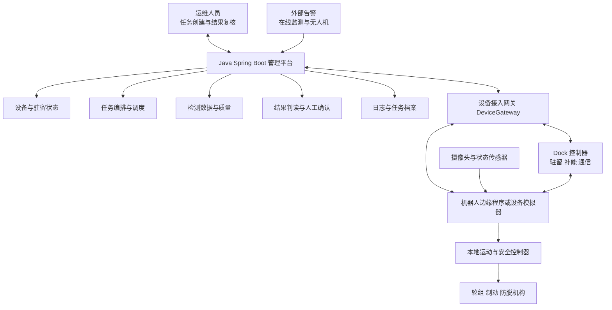

# LineGuard 项目计划书 V1.1

## 偏远难达地区架空输电线路常驻式智能运维机器人系统

项目定位：架空输电线路常驻式近距巡检系统  
产品阶段：单档距核心闭环验证  
版本日期：2026 年 9 月 10 日

LineGuard 面向高海拔、偏远山区、跨谷和高寒区段的架空输电线路。系统将机器人长期部署在架空地线或 OPGW 上，在收到远程任务后自主抵达检测位置，采集近距离图像和设备状态，上传结果并安全返回驻留节点。

# 1 项目摘要

偏远输电区段已经可以使用无人机、固定摄像头和在线监测发现异常，但近距离确认仍可能需要专业人员携带设备进入现场。山地交通、装备转运、登塔准备和高空作业共同拉长了响应流程。LineGuard 将巡检设备预先部署在线路上，使运维人员能够先获得近距离证据，再决定是否组织现场检修。

LineGuard V1 的核心功能只有一个：在限定单档距内，自主完成一次近距离巡检任务并安全返回。完整任务包括驻留待命、设备预检、沿线移动、定点停车、图像采集、结果上传、异常处理和返回对接。每个环节都记录状态，使任务结果可以复核。

系统由 LineGuard Robot、LineGuard Dock 和远程管理平台组成。Robot 负责移动和采集；Dock 负责驻留、补能、通信和对接；平台负责任务下发、状态展示、数据归档和人工确认。无人机继续承担通道及塔体的大范围巡查，人工负责安装、复杂维修和设备救援。

第一阶段围绕单档距核心闭环完成产品和软件验证。趋势诊断、轻维护工具、复杂越障和多节点协同列入后续能力，不与第一阶段的核心目标混在一起。

# 2 项目问题与目标

## 2.1 需要解决的问题

偏远区段一次巡检任务的成本不只来自检测动作，还包括人员组织、车辆与设备运输、山地通行、现场部署、登塔和撤收。平台发现疑似异常后，如果缺少近距离图像，运维人员可能需要到场后才能判断问题是否真实、是否需要维修。

LineGuard 把近距离巡检能力留在线路现场。发生异常时，机器人从附近驻留点出发，先完成细部复核。结果明确时，运维单位可以直接形成观察或检修计划；结果不足时，再安排无人机或人员补充检查。

## 2.2 目标线路与使用者

项目首选 220 kV 及以上架空线路中的人员难达区段，重点关注山区、高海拔、跨谷、道路受限和灾后通行困难位置。第一代运行对象为一种明确规格的架空地线或 OPGW，检测对象以地线表面、附件和视野内金具为主。

直接使用者包括巡检人员、状态评价人员、检修负责人和设备管理员。巡检人员创建任务并查看图像；状态评价人员结合历史记录判断异常；检修负责人决定是否派人；设备管理员关注 Robot 与 Dock 的运行状态。

## 2.3 项目目标

第一阶段以“任务能够稳定闭环”为目标，不以功能数量作为完成标准。机器人需要在给定线路模型中重复执行任务，遇到低电量、通信中断、定位异常和未知障碍时进入可解释的安全状态。

| 目标层级 | 目标内容 | 第一阶段结果 |
|---|---|---|
| 核心目标 | 单档距近距离巡检和安全返回 | 完整任务闭环 |
| 系统目标 | Robot、Dock 与平台状态一致 | 可追溯任务记录 |
| 数据目标 | 图像、位置、时间和对象正确关联 | 可供人工复核的数据 |
| 安全目标 | 异常情况下停止、返回或驻停 | 明确的故障处置结果 |

## 2.4 产品边界

第一代不追求覆盖整条线路，也不适配所有塔型和金具。复杂相导线带电维修、大型部件更换、任意障碍跨越和强风雷暴期间出勤均不在第一阶段范围内。该边界使机械设计、任务状态和验证条件保持清晰。

# 3 核心功能闭环

LineGuard 的核心能力是一条连续任务链。驻留、移动、检测、回传和返航必须作为一个整体运行；其中任何环节无法完成，任务都不能被记录为成功。

## 3.1 驻留待命与任务预检

Robot 在 Dock 中保持机械锁定并补充能源。平台接到周期任务、人工任务或外部告警后，先检查设备健康、剩余电量、通信状态、天气条件和目标路径。条件满足时任务进入待执行队列；条件不足时保留任务并说明原因。

预检是核心闭环的起点。它避免机器人在无法安全返回时出发，也避免多个任务同时占用同一节点。每次预检保存判断条件，为后续复盘提供依据。

## 3.2 自主出发与沿线移动

机器人解除 Dock 锁止后进入标定路径，依靠轮组编码器估计行程，并用视觉标记或测距信息修正位置。运动控制由本地控制器完成，平台只下发目标位置和任务类型，不持续遥控每一次电机动作。

移动过程持续监测速度、电流、姿态、通信和防脱状态。到达检测点后，机器人停车并稳定姿态。遇到位置不可信、轮组打滑或未知障碍时，机器人停止前进，根据剩余能源和路径状态选择返回或安全驻停。

## 3.3 近距离检测

第一阶段以高清 RGB 图像为主要检测数据。机器人在固定位置和固定视角下拍摄地线表面、附件和附近金具，记录断股迹象、腐蚀、异物和相对位置变化。导航画面与检测画面分开管理，避免一套摄像头同时承担所有任务。

检测记录包含目标对象、拍摄位置、时间、设备姿态和图像质量。画面模糊、遮挡或定位偏差超出要求时，系统请求重新采集；仍无法获得有效图像时，任务返回“数据不足”，交由人工决定后续方式。

## 3.4 数据回传与人工复核

机器人先上传任务状态、缩略图和关键检测结果，再根据网络状况传输原始图像。断网时数据保存在本地，恢复连接后继续上传。平台把本次数据与同一对象的历史记录放在一起，供运维人员比较。

人工复核结果分为四类：未见异常、继续观察、安排专项复检、派遣现场人员。系统保留原始图像和人工结论，不让算法评分直接替代运维判断。

## 3.5 安全返回与重新驻留

检测完成后，机器人沿已验证路线返回 Dock。到达对接区后依次确认位置、机械锁止和充电状态，再结束任务。对接失败时允许按限定次数重新尝试；超过次数后保持挂线安全状态并上报。

只有 Robot 返回、数据完成同步且 Dock 状态正常，任务才被记录为完整闭环。这样可以避免将“拍到一张照片”误认为一次成功巡检。

## 3.6 核心功能层级

| 功能层级 | 包含能力 | 当前定位 |
|---|---|---|
| 核心功能 | 驻留预检、沿线移动、定点检测、数据回传、安全返回 | 第一阶段必须完成 |
| 支撑功能 | 任务管理、设备健康、通信缓存、人工复核和安全控制 | 与核心闭环同步完成 |
| 增强功能 | 历史对比、趋势展示和多源告警接入 | 在闭环稳定后扩展 |
| 后续功能 | 指定越障、轻维护工具和多节点协同 | 不作为当前验收条件 |

## 3.7 核心任务的输入与输出

一次任务必须从明确输入开始，并生成可以直接复核的输出。任务输入包括目标设备、检测位置、任务类型、运行窗口和完成标准。机器人不接受“沿线看看”之类边界不清的指令。

| 任务阶段 | 输入 | Robot 与 Dock 动作 | 输出 |
|---|---|---|---|
| 驻留预检 | 任务单、设备状态、可用能量 | 检查锁止、通信和返程储备 | 可执行或不可执行原因 |
| 沿线移动 | 目标位置、标定路径 | 离站、移动、定位和障碍监测 | 当前距离与运动状态 |
| 定点检测 | 检测对象、拍摄要求 | 停车、稳定姿态并采集 | 图像、位置与质量标记 |
| 结果回传 | 检测数据、网络状态 | 上传关键结果并缓存原始数据 | 可供人工复核的记录 |
| 返回驻留 | 返回路径、Dock 状态 | 返航、对接、锁止和补能确认 | 完整任务结果 |

## 3.8 核心功能的完成条件

核心闭环同时满足五项条件才算完成：Robot 到达正确检测点；图像质量达到人工复核要求；任务数据与目标对象正确关联；Robot 安全返回并完成 Dock 对接；平台、Robot 与 Dock 的最终状态一致。

如果检测完成但无法返回，任务属于异常结束；如果返回成功但图像不可判读，任务属于数据失败。把运动结果、检测结果和返回结果分开记录，可以准确判断问题发生在哪个环节。

# 4 典型应用场景

三个应用场景共用同一核心闭环，只改变任务来源、优先级和检测目标。这样可以复用同一套设备、软件状态和操作流程。

## 4.1 周期性近距巡检

平台按照线路计划生成任务，Robot 在预定检测点重复拍摄。运维人员可以比较同一位置在不同时间的图像，观察地线外观、附件位置和异物变化。该场景验证设备能否稳定、重复地执行基础任务。

## 4.2 告警后的快速复核

固定监测、无人机或人工记录发现疑似异常后，平台将位置匹配到节点责任区。Robot 按较高优先级抵达目标附近，补充近距离图像。运维人员根据结果决定继续观察或安排现场处理。

## 4.3 灾害后的区段检查

强风、覆冰、雷暴或道路受阻后，系统先确认安全运行窗口。Robot 对可达范围内的地线和附件进行复核，发现断裂、明显变形或路径异常时立即停止并上传现场信息。机器人提供的是局部快速复核，不替代完整灾后巡检。

| 场景 | 任务来源 | 主要输出 | 后续决策 |
|---|---|---|---|
| 周期巡检 | 巡检计划 | 固定点位图像与设备状态 | 归档或继续观察 |
| 告警复核 | 外部告警或人工任务 | 目标附近细部图像 | 消除告警或派人 |
| 灾后检查 | 应急任务 | 可达区段现场信息 | 确定检查优先级 |

# 5 产品系统组成

## 5.1 LineGuard Robot

Robot 长期保持挂线约束，由承载机构、驱动轮组、防脱结构、控制器、摄像头、通信模块和电池组成。第一代载荷集中在移动和图像采集，结构上为后续传感器和工具接口保留安装位置。

机器人采用前后承载单元和低重心布置，优先保证稳定承载、可控往返和安全停车。控制器负责速度、位置、能量和异常监测。失电或程序异常时，机械保持和制动结构仍需维持挂线状态。

## 5.2 LineGuard Dock

Dock 设置在靠近杆塔的安全位置，为 Robot 提供机械驻留、补能、通信转发和数据同步。机器人正常返回时不完全脱离地线，而是在保持承载约束的情况下进入对接区。

Dock 包含对接标记、到位检测、锁止机构、充电接口、储能和环境监测。站点设计同时考虑防水、结冰、散热和检修空间。第一阶段可以用实验室供电模拟补能流程，后续再验证户外能源方案。

## 5.3 远程管理平台

平台以任务为中心展示线路、节点、Robot、Dock、告警和检测记录。运维人员可以创建任务、查看执行进度、复核图像、记录结论和查询设备状态。平台保留操作日志，使任务来源、执行过程和处理结果能够追溯。

## 5.4 与现有运维手段协同

无人机适合大范围取景和塔体巡查，固定传感器适合持续监测局部状态，人工负责复杂判断和维修。LineGuard 位于这些手段之间，负责已部署区段内的重复近距任务。外部系统发现异常后可以触发 Robot 复核，Robot 无法判断时再升级为无人机或人工任务。

| 系统单元 | 主要职责 | 与核心闭环的关系 |
|---|---|---|
| Robot | 移动、停车、采集和返回 | 执行核心任务 |
| Dock | 驻留、补能、对接和中继 | 提供任务起点与终点 |
| 管理平台 | 下发任务、展示状态和归档结果 | 组织并记录核心任务 |
| 现有运维系统 | 提供告警和接收处置结果 | 触发任务并承接升级任务 |

# 6 关键技术方案

## 6.1 运行对象与机械路线

第一阶段选择一种明确直径、结构和附件布置的地线样本，在非带电试验架上完成往返验证。轮槽、夹持力、附加载荷和冲击限制根据样本确定。OPGW 含有光纤单元，机构设计需要控制接触压力、弯曲和扭转影响。

首阶段路径为 Dock 到限定端点之间的单档距连续区段。已知附件在路径模型中标记，机器人到达未验证障碍前停止。防振锤、接续管和标准悬垂结构在后续阶段逐项验证。

## 6.2 定位与检测布置

编码器提供沿线行程估计，视觉标记或测距模块用于端点和检测点校正。Dock 使用独立对接标记和到位传感器，减少累计定位误差对回站的影响。

摄像头覆盖前进方向和目标区域。机器人到达检测点后停车，稳定姿态再采集图像。图像数据同时记录拍摄位置和设备姿态，为重复拍摄和历史对比提供基础。

## 6.3 能源与通信

能源预算包括移动、停车检测、计算、通信、待机和返程储备。平台在任务前计算可用能量，返程储备不足时不允许出发。后续户外 Dock 以塔侧太阳能和储能为主要方案，低温或低辐照条件下降低任务频率。

通信优先回传设备状态和关键结果，原始图像分级上传。山区网络中断时，Robot 保存任务进度和检测数据。本地控制器独立于网络保持基本安全，不依赖云端实时控制电机。

## 6.4 安全与异常处置

本地安全控制器持续监测轮组、承载、防脱、电池和姿态。通信中断时禁止开始新的工具动作；定位异常时停止前进；低电量时优先返回；机械异常时保持承载并上报。平台超时仅表示结果未知，不能自动重复执行运动指令。

| 异常 | 本地动作 | 平台处理 |
|---|---|---|
| 低电量 | 停止新增任务并返回 | 标记任务中止并检查能源 |
| 通信中断 | 缓存数据并按预案返回或驻停 | 标记离线并等待状态同步 |
| 定位异常 | 原地停车并重新定位 | 请求人工确认目标 |
| 未知障碍 | 停止前进并拍摄障碍 | 创建专项复检任务 |
| 对接失败 | 限次重试后安全驻停 | 生成 Dock 检查任务 |

## 6.5 Robot 与 Dock 协同

Dock 在机器人出发前提供任务许可，确认机械锁止已解除、通信正常且能源满足往返。Robot 离站后，Dock 保持通信中继并记录站点状态。Robot 返回时先进入低速对接区，再完成位置确认、锁止和充电握手。

对接过程采用分步确认，不能把“检测到 Robot 靠近”直接视为驻留成功。只有机械锁止信号、充电状态和 Robot 自身位置同时满足条件，平台才把任务状态改为完成。对接异常时保留 Robot 的挂线承载，避免为追求自动复位反复冲击 Dock。

# 7 软件系统架构

管理平台采用 Java 与 Spring Boot 的模块化单体。软件围绕核心任务闭环划分模块，避免在第一阶段引入与任务无关的复杂服务。

| 模块 | 主要职责 | 关键输出 |
|---|---|---|
| 设备管理 | 管理 Robot、Dock 和传感器状态 | 设备健康与可用性 |
| 任务管理 | 创建、调度、下发和跟踪任务 | 任务状态与执行记录 |
| 检测管理 | 接收图像、位置和质量信息 | 可复核检测记录 |
| 告警复核 | 接收外部告警并生成任务 | 告警与复核结论 |
| 人工确认 | 记录判断、升级和授权 | 人工结论与操作日志 |
| 数据存储 | 保存资产、任务、图像和日志 | 历史档案 |

## 7.1 核心任务状态

任务状态依次为驻留、预检、出发、移动、检测、上传、返回、对接和完成。等待人工处理、任务中止和安全驻停是独立异常状态。任何状态转换都记录触发条件、设备反馈和时间。

任务命令包含唯一编号、目标设备、目标位置和有效期。Robot 收到重复消息时只返回当前状态，不重复执行运动。断网重连后，平台先同步设备实际状态，再决定继续、返回或结束任务。

## 7.2 数据与权限

检测记录按照线路、区段、设备和目标对象组织。每次任务保存原始图像、缩略图、位置、时间、设备状态和人工结论。数据质量不足时明确标记，不将缺失结果计为正常。

巡检人员可以创建和复核任务，检修负责人负责升级处置，设备管理员负责配置与故障处理。第一阶段不开放复杂工具控制；后续加入轻维护时，再增加单独授权和操作审计。

## 7.3 核心软件接口

第一阶段的软件接口只服务于核心闭环。设备网关屏蔽模拟器和真实设备之间的通信差异，使平台在更换设备实现后仍使用同一套任务和数据模型。

| 接口 | 发送方 | 接收方 | 主要内容 |
|---|---|---|---|
| 任务下发 | 平台 | Robot | 任务编号、目标位置、有效期 |
| 状态上报 | Robot 与 Dock | 平台 | 当前状态、位置、电量和故障 |
| 检测上传 | Robot | 平台 | 图像、对象编号和质量标记 |
| 对接握手 | Robot | Dock | 靠近、到位、锁止和充电状态 |
| 异常事件 | Robot 与 Dock | 平台 | 异常类型、位置和本地动作 |

平台收到状态上报后更新任务进度，收到检测数据后生成待复核记录，收到异常事件后停止自动推进。所有接口都使用任务编号关联，避免不同任务的数据混入同一记录。

# 8 第一阶段实施方案

第一阶段只实现单档距核心闭环。软件可以先接入设备模拟器，再接入非带电试验架。这样能够分别验证任务逻辑、数据流程和机械能力。

## 8.1 工作内容

| 工作包 | 主要工作 | 输出物 |
|---|---|---|
| 场景与需求 | 明确目标线路、检测点、角色和边界 | 需求清单与任务流程 |
| Robot 与 Dock 设计 | 完成机构概念、接口和状态定义 | 产品方案与接口清单 |
| 软件实现 | 完成设备、任务、检测和复核模块 | Java 原型与设备模拟器 |
| 闭环联调 | 打通预检、移动、采集、上传和返回 | 可运行任务演示 |
| 异常验证 | 注入断网、低电量、障碍和对接失败 | 测试记录与改进清单 |

## 8.2 演示流程

演示从平台创建任务开始。系统检查 Robot 和 Dock 状态，Robot 离站后沿模拟线路移动，在指定位置停车并上传图像。运维人员在平台完成复核，机器人随后返回 Dock。演示中分别注入断网和低电量，展示系统如何进入返回或安全驻停。

## 8.3 验收标准

| 验收对象 | 检查内容 | 达成表现 |
|---|---|---|
| 正常闭环 | 预检、出发、检测、上传、返回、对接 | 全部状态连续且可追溯 |
| 数据完整 | 图像、位置、时间和目标对象关联 | 缺失数据可识别并重采 |
| 异常处理 | 断网、低电量、重复消息和障碍 | 不误执行并进入安全状态 |
| 状态一致 | 平台、Robot 与 Dock 记录 | 重连后状态保持一致 |
| 人工复核 | 原始图像和处理结论 | 任务能够形成明确结果 |

## 8.4 阶段安排

第一步冻结目标场景和核心状态；第二步完成 Robot、Dock 与平台接口；第三步实现 Java 平台和设备模拟器；第四步打通完整任务并进行异常测试；第五步整理验证结果，确定下一阶段是否进入机械样机和长期驻留验证。

## 8.5 原型范围

第一阶段原型包含任务管理页面、设备状态页面、检测结果页面和任务记录页面。设备模拟器能够接收任务、按时间推进状态、上传示例图像，并注入断网、低电量、障碍和对接失败。

| 原型部分 | 必须实现 | 暂不实现 |
|---|---|---|
| 管理平台 | 任务创建、状态查看、结果复核和历史记录 | 复杂统计和多组织管理 |
| Robot 模拟器 | 移动、检测、返回和异常状态 | 真实越障算法 |
| Dock 模拟器 | 驻留、解锁、对接和补能状态 | 户外能源控制 |
| 检测模块 | RGB 图像上传和质量标记 | 自动寿命预测 |

原型演示以一条完整任务为主，不通过同时展示大量页面增加复杂度。正常闭环与异常闭环使用同一套任务状态，便于说明系统逻辑。

# 9 风险与产品边界

## 9.1 主要风险

| 风险 | 影响 | 当前控制方式 |
|---|---|---|
| 挂线和承载不可靠 | 设备掉落或损伤线路 | 双重防脱、非带电试验和载荷检查 |
| 路径或障碍识别错误 | Robot 卡滞或无法返回 | 标定路线和障碍白名单 |
| 能源不足 | 任务中断 | 任务前预算和返程储备 |
| 通信不稳定 | 状态未知或数据丢失 | 本地控制、数据缓存和状态同步 |
| 图像无法判读 | 无法形成巡检结论 | 固定视角、质量检查和重采 |
| Dock 对接失败 | 无法补能 | 对接检测、限次重试和安全驻停 |

## 9.2 运行边界

Robot 只在已验证线型和路径上运行。第一阶段不跨越耐张塔和未验证金具，不接触相导线，不进入雷暴、强风或严重覆冰环境。线路出现明显断裂、变形或承载状态未知时，机器人停止移动。

LineGuard 提供局部近距巡检结果，不替代线路的完整巡视、安全制度和专业检修。设备自身发生故障时，按照预留吊点、位置记录和现场方案执行救援。

## 9.3 后续能力边界

历史趋势、红外、振动和接触检测可以在核心闭环稳定后加入。轻维护仅考虑目标明确、动作可限力、结果可检查且工具可回收的任务。每增加一种附件、检测载荷或工具，都需要重新验证机械、安全和软件状态。

# 10 项目价值与发展方向

LineGuard 的直接价值是缩短“发现异常到获得近距离证据”的流程。对周期性任务，系统能够重复采集同一位置；对告警任务，系统能够在节点可达范围内快速复核；对灾后任务，系统能够在安全窗口恢复后提供局部现场信息。

第一阶段完成后，项目应先判断核心闭环是否稳定，再选择下一项能力。若移动、检测和返回仍不可靠，就继续优化 Robot 与 Dock；若闭环稳定，则优先验证一种典型附件越障和一种附加检测载荷。

| 发展阶段 | 能力重点 | 进入条件 |
|---|---|---|
| 第一阶段 | 单档距巡检闭环 | 软件、设备和数据状态完整 |
| 第二阶段 | 指定附件越障 | 基础往返稳定 |
| 第三阶段 | 长期驻留与自动补能 | Dock 对接和能源稳定 |
| 第四阶段 | 趋势检测与有限轻维护 | 连续数据和核心任务可靠 |
| 第五阶段 | 多节点协同 | 单节点运行边界明确 |

# 11 阶段性结论

LineGuard V1 聚焦一项清晰能力：机器人在偏远输电区段长期驻留，收到任务后自主完成近距离巡检并安全返回。Robot、Dock 和管理平台均围绕这条任务链设计。

第一阶段的完成标志是任务闭环可以重复执行，数据能够支持人工复核，异常状态能够停止、返回或驻停。趋势诊断、轻维护和多节点协同在此基础上逐步扩展，不影响当前产品目标。

# 附录 A 项目一句话介绍

LineGuard 在偏远输电区段常驻待命，自主完成近距离巡检、结果回传和安全返航。

# 附录 B 核心闭环演示脚本

1. 运维人员在平台选择线路区段和检测点，创建近距巡检任务。
2. 平台检查 Robot、Dock、通信和电量，确认任务可以执行。
3. Robot 解锁离站，沿标定线路移动并持续上传状态。
4. Robot 到达检测点，停车拍摄并上传图像。
5. 运维人员查看图像并记录复核结论。
6. Robot 返回 Dock，完成机械锁止、充电确认和数据同步。
7. 平台生成完整任务记录，展示各状态、用时和异常信息。

# 附录 C 后续功能清单

后续功能包括指定附件越障、红外与振动检测、历史趋势分析、传感器部署、限定轻维护和多节点协同。每项功能独立立项和验证，不改变第一阶段“近距巡检闭环”的核心定位。
