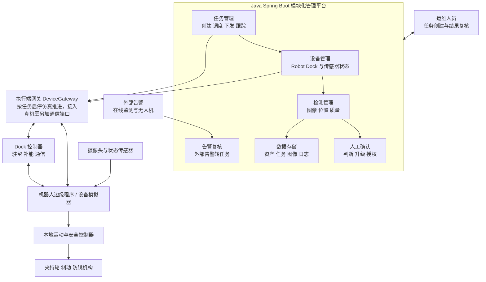
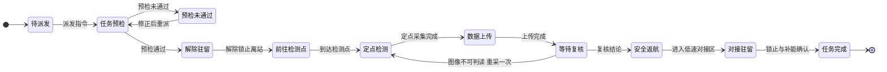
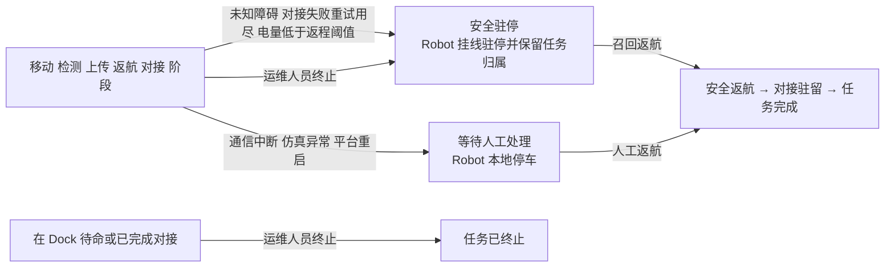
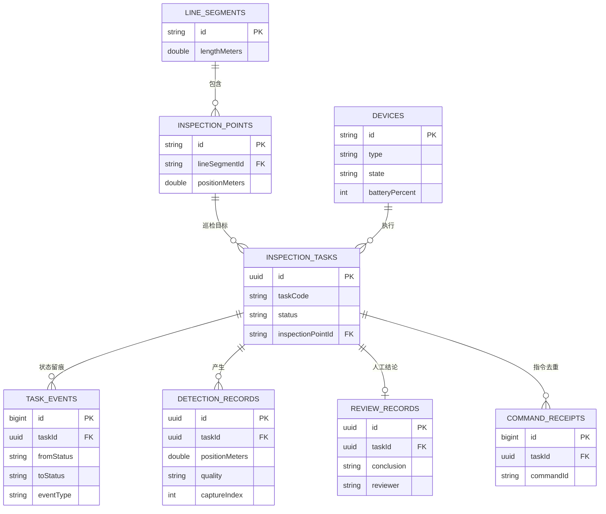
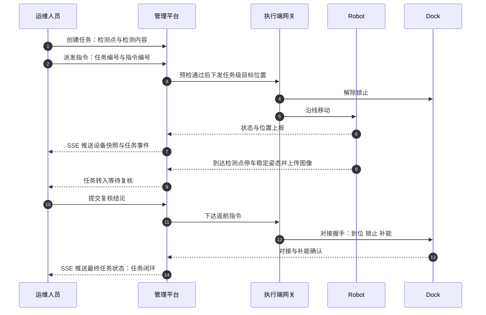
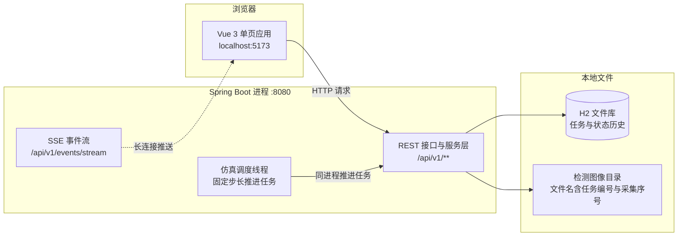

# LineGuard 项目计划书 V2.0

## 偏远难达地区架空输电线路常驻式智能运维机器人系统

项目定位：架空输电线路常驻式近距巡检系统  
产品阶段：单档距核心闭环验证  
版本日期：2026 年 9 月 17 日

这个项目的起点是一次很具体的对话。我们问了几位做线路运维的工程师同一个问题："发现一个疑似断股，你多久能到现场看清？"答案通常是当天不行，最快第二天，遇到山区道路受阻就说不准。无人机和在线监测已经能告诉他们"这里可能有问题"，但从"可能"到"看清"，中间仍然要有人上山。

LineGuard 想补的就是这一段。系统把机器人长期部署在架空地线或 OPGW 上，收到任务后自主抵达检测位置，采集近距离图像和设备状态，上传结果并安全返回驻留节点。

# 1 项目摘要

偏远输电区段已经可以使用无人机、固定摄像头和在线监测发现异常，但近距离确认仍可能需要专业人员携带设备进入现场。山地交通、装备转运、登塔准备和高空作业共同拉长了响应流程。LineGuard 将巡检设备预先部署在线路上，使运维人员能够先获得近距离证据，再决定是否组织现场检修。

全国 220 千伏及以上输电线路约 92 万公里（截至 2023 年底），其中相当比例位于车辆难以到达的山地。这部分线路的巡视成本主要由人的往返构成，而不由检测动作构成——这正是把设备留在现场能够改变的地方。本文的全部推演基于一个具体的示范场景：云岭示范区段，一条单档距 1000 米、带两个检测点的架空地线区段。

LineGuard V1 的核心功能只有一个：在限定单档距内，自主完成一次近距离巡检任务并安全返回。完整任务包括驻留待命、设备预检、沿线移动、定点停车、图像采集、结果上传、异常处理和返回对接。每个环节都记录状态，使任务结果可以复核。

系统由 LineGuard Robot、LineGuard Dock 和远程管理平台组成。Robot 负责移动和采集；Dock 负责驻留、补能、通信和对接；平台负责任务下发、状态展示、数据归档和人工确认。无人机继续承担通道及塔体的大范围巡查，人工负责安装、复杂维修和设备救援。

第一阶段的完成标志是一件很小的事：任务能够重复跑通，数据能支持人工复核，异常时机器人知道该停下、返回还是驻停。趋势诊断、轻维护工具、复杂越障和多节点协同都在这个基础之上。

# 2 问题、目标与边界

## 2.1 需要解决的问题

偏远区段一次巡检任务的成本不只来自检测动作，还包括人员组织、车辆与设备运输、山地通行、现场部署、登塔和撤收。平台发现疑似异常后，如果缺少近距离图像，运维人员可能需要到场后才能判断问题是否真实、是否需要维修。LineGuard 把近距离巡检能力留在线路现场：发生异常时机器人从附近驻留点出发先完成细部复核，结果明确时直接形成观察或检修计划，结果不足时再安排无人机或人员补充检查。

## 2.2 目标线路与使用者

项目首选 220 kV 及以上架空线路中的人员难达区段，重点关注山区、高海拔、跨谷、道路受限和灾后通行困难位置。第一代运行对象为一种明确规格的架空地线或 OPGW，检测对象以地线表面、附件和视野内金具为主。

直接使用者包括巡检人员、状态评价人员、检修负责人和设备管理员：巡检人员创建任务并查看图像，状态评价人员结合历史记录判断异常，检修负责人决定是否派人，设备管理员关注 Robot 与 Dock 的运行状态。采购与运维由省检修公司或地市运检部门承担，因此项目需要说服的实际上是设备管理员与检修负责人——前者关心设备可靠性和运维工作量，后者关心"拿到这张图之后能不能少派一次人"。

## 2.3 项目目标

第一阶段以"任务能够稳定闭环"为目标，不以功能数量作为完成标准。机器人需要在给定线路模型中重复执行任务，遇到低电量、通信中断、定位异常和未知障碍时进入可解释的安全状态。

| 目标层级 | 目标内容 | 第一阶段结果 |
|---|---|---|
| 核心目标 | 单档距近距离巡检和安全返回 | 完整任务闭环 |
| 系统目标 | Robot、Dock 与平台状态一致 | 可追溯任务记录 |
| 数据目标 | 图像、位置、时间和对象正确关联 | 可供人工复核的数据 |
| 安全目标 | 异常情况下停止、返回或驻停 | 明确的故障处置结果 |

第一代运行范围为一种已验证线型的单档距区段。复杂相导线带电维修、大型部件更换、任意障碍跨越和强风雷暴期间出勤不在第一阶段范围内——这些边界使机械设计、任务状态和验证条件保持清晰，也决定了第一条验证线路应当选在哪里。

# 3 市场、客户与单位经济性

## 3.1 市场与客户

全国 220 千伏及以上输电线路长度约 92 万公里，较 2013 年增长约 69.1%（国家能源局，2024 年 7 月）。南方电网曾在公开报道中说明，其 80% 以上的线路位于远离城镇、人烟稀少的高山峻岭地区（中国能源报，2015 年）。后者是 2015 年针对单一电网公司的表述，用于说明地形分布的量级，不作为全国统计口径。

对本项目而言，真正可服务的是"人员难达且已具备部署条件"的区段，而不是全部线路里程。这一口径需要与目标客户共同确定，属于需要现场核实的参数，我们在 3.3 中把它列为假设而非结论。

## 3.2 与现有运维手段的分工

| 手段 | 覆盖粒度 | 单次成本结构 | 主要局限 | 依据 |
|---|---|---|---|---|
| 人工登塔巡检 | 部件级 | 人员往返与登塔作业，按人日计 | 受地形与天气限制，响应以天计 | 待核实 |
| 无人机巡检 | 通道与塔体级 | 设备摊销与飞手人日 | 地线表面等细部视角受限，受空域与风速约束 | 待核实 |
| 固定摄像头 | 单点持续 | 一次性安装与通信维护 | 只能覆盖安装点，视角固定 | 待核实 |
| 在线监测装置 | 单点持续 | 一次性安装与供电维护 | 给出趋势判断，不给视觉证据 | 待核实 |
| LineGuard | 已部署区段近距 | 设备折旧与部署摊销 | 只覆盖已部署区段，需配套 Dock | 待核实 |

这张表目前是量级判断，不是采购依据。我们刻意没有填入未经核实的金额：这些取值必须在样机阶段通过目标客户的运维口径复核，复核方式列在 3.3 的参数表中。

## 3.3 单位经济性

先把成本写成一个可以代入的式子，而不是先给结论：

单次摊销成本 = 单套设备成本 ÷ (设计寿命年数 × 年任务次数) + 维护与部署年支出 ÷ 年任务次数

机器人只有在"单次人工往返成本 > 单次摊销成本"时才具备经济性，也就是年任务次数要超过盈亏平衡值 N\* = 年化固定成本 ÷ 单次人工巡检的往返成本，其中年化固定成本 = 单套设备成本 ÷ 设计寿命年数 + 年维护 + 年部署摊销；两个式子里的"次数"必须取同一个口径。式中两个关键取值目前都无法从公开资料可靠获得，因此我们只给出区间而不给唯一结论：

| 参数 | 取值区间 | 依据 | 验证方式 |
|---|---|---|---|
| 单套设备成本 | 待定 | 未定型，无有效报价 | 样机 BOM 与外协报价 |
| 设计寿命 | 5 ~ 8 年 | 按户外机电设备一般寿命假设 | 加速老化与现场考核 |
| 单次人工巡检往返成本 | 待定 | 公开资料无可靠口径 | 向目标客户调取人日与车辆口径 |
| 年任务次数 | 20 ~ 60 次 | 按巡视频次与告警次数假设 | 客户历史工单统计 |

在取值明确之前，任何盈亏平衡结论都是不可信的。这一判断本身就是第一阶段的产出之一：样机阶段要拿到的是这四个数的实际范围，而不是继续论证一个假设。

# 4 核心功能闭环

LineGuard 的核心能力是一条连续任务链。驻留、移动、检测、回传和返航必须作为一个整体运行；其中任何环节无法完成，任务都不能被记录为成功。

## 4.1 驻留待命与任务预检

Robot 在 Dock 中保持机械锁定并补充能源。平台接到周期任务、人工任务或外部告警后，先检查设备健康、剩余电量、通信状态、天气条件和目标路径。条件满足时任务进入待执行队列；条件不足时保留任务并说明原因。预检是核心闭环的起点：它避免机器人在无法安全返回时出发，也避免多个任务同时占用同一节点，每次判断条件都会保存下来供后续复盘。

## 4.2 自主出发与沿线移动

机器人解除 Dock 锁止后进入标定路径，依靠夹持轮编码器估计行程，并用视觉标记或测距信息修正位置。运动控制由本地控制器完成，平台只下发目标位置和任务类型，不持续遥控每一次电机动作。移动过程持续监测速度、电流、姿态、通信和防脱状态；到达检测点后停车并稳定姿态。遇到位置不可信、夹持轮打滑或未知障碍时，机器人停止前进，根据剩余能源和路径状态选择返回或安全驻停。

## 4.3 近距离检测

第一阶段以高清 RGB 图像为主要检测数据。机器人在固定位置和固定视角下拍摄地线表面、附件和附近金具，记录断股迹象、腐蚀、异物和相对位置变化。导航画面与检测画面分开管理，避免一套摄像头同时承担所有任务。检测记录包含目标对象、拍摄位置、时间、设备姿态和图像质量；画面模糊、遮挡或定位偏差超出要求时系统请求重新采集，仍无法获得有效图像时任务返回"数据不足"，交由人工决定后续方式。

## 4.4 数据回传与人工复核

机器人先上传任务状态、缩略图和关键检测结果，再根据网络状况传输原始图像。断网时数据保存在本地，恢复连接后继续上传；平台把本次数据与同一对象的历史记录放在一起，供运维人员比较。人工复核结果分为四类：未见异常、继续观察、安排专项复检、派遣现场人员。系统保留原始图像和人工结论，不让算法评分直接替代运维判断。

## 4.5 安全返回与完成条件

检测完成后，机器人沿已验证路线返回 Dock，到达对接区后依次确认位置、机械锁止和充电状态，再结束任务；对接失败时允许按限定次数重新尝试，超过次数后保持挂线安全状态并上报。

核心闭环同时满足五项条件才算完成：Robot 到达正确检测点；图像质量达到人工复核要求；任务数据与目标对象正确关联；Robot 安全返回并完成 Dock 对接；平台、Robot 与 Dock 的最终状态一致。如果检测完成但无法返回，任务属于异常结束；如果返回成功但图像不可判读，任务属于数据失败。把运动结果、检测结果和返回结果分开记录，可以准确判断问题发生在哪个环节，具体状态与迁移规则见 7.1。

# 5 应用场景与系统组成

## 5.1 三个应用场景

三类任务共用同一闭环，只改变任务来源、优先级和检测目标。周期性近距巡检由平台按线路计划生成任务，机器人在预定检测点重复拍摄，用于比较同一位置在不同时间的图像；告警后的快速复核由固定监测、无人机或人工记录触发，平台把位置匹配到节点责任区后以较高优先级派机器人补充近距离图像；灾害后的区段检查在确认安全运行窗口后，对可达范围内的地线和附件做局部快速复核，发现断裂、明显变形或路径异常时立即停止并上传现场信息。三者都不替代完整的灾后巡视或专业检修。

## 5.2 LineGuard Robot

Robot 长期保持挂线约束，由夹持行走机构、承载单元、控制器、摄像头、通信模块和电池组成。行走不靠机体自重压线，而是由前后两个夹持站点把地线夹在上、下 V 槽轮之间：下轮由预压弹簧顶紧，上轮由电机经锥齿轮驱动，牵引力取决于弹簧产生的法向力而非机器人重量，因此爬坡、覆冰和倒挂工况都不会打滑；一台电机同时带动一对正反夹持轮，两轮对地线同向推，扭矩不做内部抵消。两个站点共四个 V 槽轮形成四点接触，除行进方向外的自由度都被约束，夹持框架同时兼作防脱。控制器负责速度、位置、能量和异常监测；失电或程序异常时，轮槽与框架的机械保持仍维持挂线状态。机体吊挂在夹持框架下方并配低重心电池，抑制行走摆动。第一代载荷集中在移动和图像采集，结构上为后续传感器和工具接口保留安装位置。

<!-- 图注：Robot 挂线断面与功能单元组成 -->
<!-- 截图：cross-section -->

## 5.3 LineGuard Dock

Dock 设置在靠近杆塔的安全位置，为 Robot 提供机械驻留、补能、通信转发和数据同步，包含对接标记、到位检测、锁止机构、充电接口、储能和环境监测。机器人正常返回时不完全脱离地线，而是在保持承载约束的情况下进入对接区。站点设计同时考虑防水、结冰、散热和检修空间；第一阶段用实验室供电模拟补能流程，户外能源方案在样机阶段验证。

<!-- 图注：Dock 对接分步——接近对位与锁止充电 -->
<!-- 截图：docking -->

## 5.4 远程管理平台与协同分工

平台以任务为中心展示线路、节点、Robot、Dock、告警和检测记录，运维人员可以创建任务、查看执行进度、复核图像、记录结论和查询设备状态，平台保留操作日志使任务来源、执行过程和处理结果能够追溯。

无人机适合大范围取景和塔体巡查，固定传感器适合持续监测局部状态，人工负责复杂判断和维修。LineGuard 位于这些手段之间，负责已部署区段内的重复近距任务：外部系统发现异常后可以触发复核，机器人无法判断时再升级为无人机或人工任务。

# 6 关键技术方案

## 6.1 机械路线与运行对象

第一阶段选择一种明确直径、结构和附件布置的地线样本，在非带电试验架上完成往返验证，轮槽槽底半径、夹持力上限、附加载荷和冲击限制逐项标定。OPGW 含有光纤单元，机构设计需要控制接触压力、弯曲和扭转影响。首阶段路径为 Dock 到限定端点之间的单档距连续区段，已知附件在路径模型中标记，机器人到达未验证障碍前停止，防振锤、接续管和标准悬垂结构在后续阶段逐项验证。

<!-- 图注：Robot 外形三视图（标注为模型外形包络，含云台与配重） -->
<!-- 截图：three-views -->

## 6.2 定位与检测布置

编码器提供沿线行程估计，视觉标记或测距模块用于端点和检测点校正；Dock 使用独立对接标记和到位传感器，减少累计定位误差对回站的影响。摄像头覆盖前进方向和目标区域，机器人到达检测点后停车、稳定姿态再采集图像，图像数据同时记录拍摄位置和设备姿态，为重复拍摄和历史对比提供基础。

## 6.3 能源与通信

能源预算包括移动、停车检测、计算、通信、待机和返程储备，平台在任务前计算可用能量，返程储备不足时不允许出发。后续户外 Dock 以塔侧太阳能和储能为主要方案，低温或低辐照条件下降低任务频率。通信优先回传设备状态和关键结果，原始图像分级上传；山区网络中断时 Robot 保存任务进度和检测数据，本地控制器独立于网络保持基本安全，不依赖云端实时控制电机。

## 6.4 安全与异常处置

本地安全控制器持续监测夹持轮、承载、防脱、电池和姿态：通信中断时禁止开始新的工具动作，定位异常时停止前进，低电量时优先返回，机械异常时保持承载并上报。平台超时仅表示结果未知，不能自动重复执行运动指令。

| 异常 | 本地动作 | 平台处理 |
|---|---|---|
| 低电量 | 停止新增任务并返回 | 自动返航，与人工返航共用同一套联锁；电量低于安全阈值时转安全驻停 |
| 通信中断 | 缓存数据并按预案返回或驻停 | 标记离线并等待状态同步 |
| 定位异常 | 原地停车并重新定位 | 请求人工确认目标 |
| 未知障碍 | 停止前进并拍摄障碍 | 创建专项复检任务 |
| 对接失败 | 限次重试后安全驻停 | 生成 Dock 检查任务 |

Dock 在机器人出发前提供任务许可，确认机械锁止已解除、通信正常且能源满足往返；Robot 离站后 Dock 保持通信中继并记录站点状态，返回时先进入低速对接区，再完成位置确认、锁止和充电握手。对接采用分步确认，不能把"检测到 Robot 靠近"直接视为驻留成功。

# 7 软件系统架构

管理平台采用 Java 与 Spring Boot 的模块化单体，按设备管理、任务管理、检测管理、告警复核、人工确认和数据存储六个模块划分，避免在早期引入与任务无关的复杂服务。

<!-- 图注：系统逻辑架构 -->

平台只下发任务级指令，运动与安全动作由本地控制器执行。

## 7.1 核心任务状态

任务状态依次为驻留、预检、出发、移动、检测、上传、等待复核、返回、对接和完成。等待人工处理、任务中止和安全驻停是独立异常状态，任何状态转换都记录触发条件、设备反馈和时间。

<!-- 图注：核心任务状态（正常闭环） -->

正常闭环之外还有两条可自动重试的支线：预检未通过时可以修正后重新派发，图像不可判读时允许在原位重新采集一次。其余异常会进入安全驻停或等待人工处理，机器人保持挂线承载，只有人工下达召回或返航指令才会重新移动。终止只在机器人仍驻留于 Dock 时才结束任务；已经离站时终止只会转入安全驻停并保留任务归属，必须先召回——挂线约束优先于任务状态。

<!-- 图注：异常状态与恢复路径 -->

状态机以白名单方式实现：未列出的转换会被拒绝，终态没有出口。任务携带目标设备、目标位置和有效期，指令携带唯一编号，Robot 收到重复消息时只返回当前状态、不重复执行运动；断网重连后平台先同步设备实际状态，再决定继续、返回或结束任务。

## 7.2 数据模型与角色分工

检测记录按照线路、区段、设备和目标对象组织，每次任务保存原始图像、缩略图、位置、时间、设备状态和人工结论；数据质量不足时明确标记，不将缺失结果计为正常。

<!-- 图注：数据模型 -->

实体之间是应用层维护的逻辑引用，数据库未建立外键约束，以便后续按区段或按年度归档时保持调整空间；指令去重表在任务编号与指令编号上有唯一约束，重复指令会在此处被拦截。巡检人员、状态评价人员、检修负责人与设备管理员的职责划分见 2.2，那是组织上的分工；**原型阶段不做身份与权限校验**，复核结论的填写人由界面固定填入，正式系统需要与客户已有的身份体系对接。

## 7.3 核心软件接口与交互

平台与设备执行端之间目前只有一条窄边界：`DeviceGateway` 按任务启停执行端的推进（`startOrResume` / `stop` / `stopAll`），当前实现把它交给内置仿真调度器按固定步长推进。设备状态本身由平台侧的仿真逻辑算出并直接落库，因此"任务下发、状态上报、检测上传、对接握手和异常事件"这五类交互在这一阶段都是同进程内的调用，还不是一条可替换的设备通信链路；接入真实设备需要新增通信端口（下发与上报）并重新审视"设备即数据库记录"这个假设，任务状态机与数据模型可以保持不动。

<!-- 图注：单次任务的全链路交互 -->

## 7.4 部署视图

第一阶段按单机部署：一个 Spring Boot 进程同时承载管理平台与仿真调度，检测图像与任务数据落在本地文件系统，运维人员通过浏览器访问。

<!-- 图注：原型部署形态 -->

该部署形态用于验证任务逻辑与数据流程。接入真实设备还需要新增设备通信端口、替换仿真调度，并把"设备状态直接落库"改为通过端口收发；正式数据库是另一项独立工作。任务状态机与数据模型可以保持不动。

# 8 第一阶段实施方案与验收

第一阶段只实现单档距核心闭环，软件先接入设备模拟器，再接入非带电试验架，以便分别验证任务逻辑、数据流程和机械能力。

## 8.1 工作内容

工作分五块：确定目标线路、检测点、角色与边界，产出需求清单；完成 Robot 与 Dock 的机构概念、接口和状态定义；实现设备、任务、检测与复核模块的 Java 原型与模拟器；打通预检、移动、采集、上传和返回的闭环联调；注入断网、低电量、障碍和对接失败，输出测试记录与改进清单。

## 8.2 演示流程

1. 运维人员在平台选择"云岭示范区段"与检测点，创建近距巡检任务。
2. 平台检查 Robot、Dock、通信和电量，确认任务可以执行。
3. Robot 解锁离站，沿标定线路移动并持续上传状态。
4. Robot 到达检测点，停车拍摄并上传图像。
5. 运维人员查看图像并记录复核结论。
6. Robot 返回 Dock，完成机械锁止、充电确认和数据同步。
7. 平台生成完整任务记录，展示各状态、用时和异常信息。
8. 在任务运行中终止任务，观察 Robot 进入安全驻停；随后下达召回返航，确认任务按闭环收尾。

原型包含任务管理、设备状态、检测结果和任务记录页面；设备模拟器能够接收任务、按时间推进状态、上传示例图像并注入故障。演示以一条完整任务为主线，正常闭环与异常闭环使用同一套任务状态。

<!-- 图注：原型任务控制台的运行视图 -->
<!-- 截图：console-running -->

## 8.3 验收标准

| 验收对象 | 检查内容 | 达成表现 |
|---|---|---|
| 正常闭环 | 预检、出发、检测、上传、返回、对接 | 全部状态连续且可追溯 |
| 数据完整 | 图像、位置、时间和目标对象关联 | 缺失数据可识别并重采 |
| 异常处理 | 断网、低电量、重复消息和障碍 | 不误执行并进入安全状态 |
| 状态一致 | 平台、Robot 与 Dock 记录 | 重连后状态保持一致 |
| 人工复核 | 原始图像和处理结论 | 任务能够形成明确结果 |

表中除"数据完整"外，其余四行在原型里都有对应的自动化验证，可复现：正常闭环由后端集成测试断言完整的事件子序列；异常处理中的低电量返航、通信中断转人工、未知障碍与解除、Dock 对接失败重试、重复指令各有独立用例；状态一致由「重启后任务、Robot 与 Dock 三方一致」和「前端断线重连后回源补齐」两个用例覆盖；人工复核在闭环用例中以"提交复核结论并完成任务"的形式覆盖。"数据完整"一行目前只做到"不可判读的图像被明确标记、允许原位重采"，还没有自动化断言。

测试位于 `lineguard-system/backend/src/test` 与 `lineguard-system/frontend/src`，两端的运行命令见仓库根目录 `README.md`。

## 8.4 阶段安排

第一步冻结目标场景和核心状态；第二步完成 Robot、Dock 与平台接口；第三步实现 Java 平台和设备模拟器；第四步打通完整任务并进行异常测试；第五步整理验证结果，决定下一阶段是否进入机械样机和长期驻留验证。

# 9 风险与取舍

| 风险 | 影响 | 当前控制方式 |
|---|---|---|
| 挂线和承载不可靠 | 设备掉落或损伤线路 | 双重防脱、非带电试验和载荷检查 |
| 路径或障碍识别错误 | Robot 卡滞或无法返回 | 标定路线和障碍白名单 |
| 能源不足 | 任务中断 | 任务前预算和返程储备 |
| 通信不稳定 | 状态未知或数据丢失 | 本地控制、数据缓存和状态同步 |
| 图像无法判读 | 无法形成巡检结论 | 固定视角、质量检查和重采 |
| Dock 对接失败 | 无法补能 | 对接检测、限次重试和安全驻停 |

以下三处是我们主动放弃的东西，列出它们比列出边界更有信息量。第一，不追求一次任务覆盖整条线路：多节点协同的成本不在机器人本身，而在每个节点的 Dock 与通信，第一阶段用它换取单点可靠性。第二，暂不做轻维护：机械臂或工具头的价值取决于动作可限力和结果可检查，在移动与检测尚不稳定时引入工具，会把安全责任和验证复杂度同时放大。第三，暂不接入自动缺陷识别：运维人员当前需要的是一张能看清的图，而不是一个需要二次验证的评分。

Robot 只在已验证线型和路径上运行，不跨越耐张塔和未验证金具，不接触相导线，不进入雷暴、强风或严重覆冰环境；线路出现明显断裂、变形或承载状态未知时停止移动。设备自身发生故障时，按照预留吊点、位置记录和现场方案执行救援。

# 10 项目价值与发展方向

LineGuard 的直接价值是缩短"发现异常到获得近距离证据"的流程。对周期性任务，系统能够重复采集同一位置；对告警任务，系统能够在节点可达范围内快速复核；对灾后任务，系统能够在安全窗口恢复后提供局部现场信息。

第一阶段完成后，项目应先判断核心闭环是否稳定，再选择下一项能力。若移动、检测和返回仍不可靠，就继续优化 Robot 与 Dock；若闭环稳定，则优先验证一种典型附件越障和一种附加检测载荷。每增加一种附件、检测载荷或工具，都需要重新验证机械、安全和软件状态，因此每项功能独立立项，不改变"近距巡检闭环"的核心定位。历史趋势、红外、振动和接触检测可以在核心闭环稳定后加入；轻维护仅考虑目标明确、动作可限力、结果可检查且工具可回收的任务。

| 发展阶段 | 能力重点 | 进入条件 |
|---|---|---|
| 第一阶段 | 单档距巡检闭环 | 软件、设备和数据状态完整 |
| 第二阶段 | 指定附件越障 | 基础往返稳定 |
| 第三阶段 | 长期驻留与自动补能 | Dock 对接和能源稳定 |
| 第四阶段 | 趋势检测与有限轻维护 | 连续数据和核心任务可靠 |
| 第五阶段 | 多节点协同 | 单节点运行边界明确 |

# 附录 参考数据来源

| 引用内容 | 来源 | 年份 | 口径 | 链接 |
|---|---|---|---|---|
| 220 千伏及以上输电线路约 92 万公里，较 2013 年增长约 69.1% | 国家能源局 | 2024 | 全国，截至 2023 年底 | [nea.gov.cn](https://www.nea.gov.cn/2024-07/19/c_1310782066.htm) |
| 80% 以上线路位于远离城镇、人烟稀少的高山峻岭地区 | 中国能源报（南方电网受访者表述） | 2015 | 单一电网公司，地形分布 | [中国能源报](https://paper.people.com.cn/zgnyb/html/2015-12/21/content_1642449.htm) |

除上表外，本文出现的成本、寿命与任务次数均为待核实参数：公开渠道查不到可直接引用的单项巡检成本口径，因此这些数按假设处理，取值区间与验证方式见 3.3，不作为采购或投资依据。
